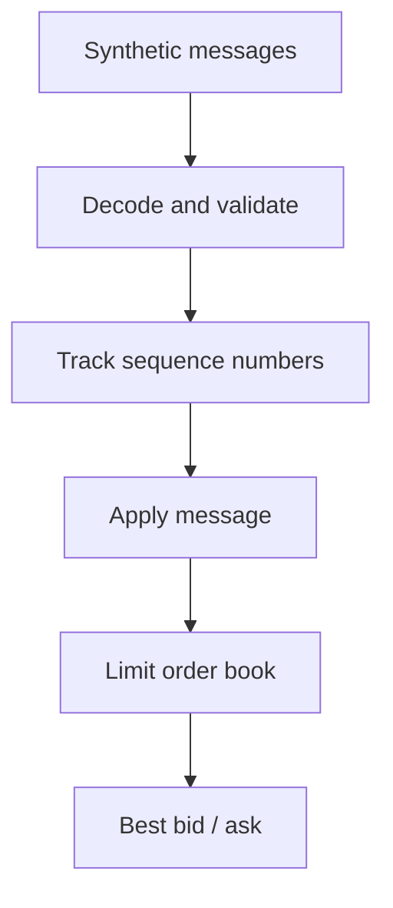

[](https://github.com/Ghaith8Bit/simple-hft-engine/actions/workflows/ci.yml)

# Simple HFT Engine

A Rust systems-engineering project exploring low-latency market-data processing through zero-copy decoding, sequence tracking, and a fixed-depth limit order book.

The project demonstrates implementation techniques and benchmarking methods. It is an educational prototype, **not a production trading system or a connection to a live exchange**.

## What it does

- Encodes and decodes a synthetic, fixed-size market-data message format.
- Uses `zerocopy` to borrow structured messages directly from aligned input buffers.
- Tracks sequence numbers and reports gaps, duplicates, and out-of-order messages.
- Applies add and cancel messages to a price-aggregated limit order book.
- Provides a synthetic in-memory processing pipeline and a separate UDP demonstration.
- Benchmarks selected decoding, order-book, and timing operations.

## Architecture at a glance



This diagram represents the conceptual processing path. The in-memory pipeline and UDP demonstration are separate execution paths. The UDP demonstration is not part of the in-memory pipeline benchmark.

## Workspace

| Crate | Responsibility |
| --- | --- |
| `hft-core` | Core types such as prices, quantities, timestamps, and sides |
| `hft-orderbook` | Fixed-depth, price-aggregated limit order book |
| `hft-feed` | Message format, decoding, sequence tracking, replay helpers, pipeline, and UDP demo |
| `hft-benchmarks` | Timing, statistics, and CPU-affinity utilities |

## Get started

Install a stable Rust toolchain with Cargo, then run these commands from the repository root.

### Run the tests

```bash
cargo test --workspace --release
```

### Run the synthetic in-memory pipeline

```bash
cargo run -p hft-feed --release --bin pipeline
```

Run five times with reduced output:

```bash
cargo run -p hft-feed --release --bin pipeline -- --runs 5 --quiet
```

### Run the benchmarks

Order-book read benchmark using RDTSC:

```bash
cargo bench -p hft-orderbook --bench book_rdtsc
```

Decoder benchmarks:

```bash
cargo bench -p hft-feed --bench decode
```

Compile all benchmark targets without running them:

```bash
cargo bench --workspace --no-run
```

### Validate the code

Check formatting:

```bash
cargo fmt --all -- --check
```

Run Clippy:

```bash
cargo clippy --workspace --all-targets -- -D warnings
```

See [`BENCHMARKS.md`](BENCHMARKS.md) for additional commands, recorded results, measurement methods, and reproduction details.

## Learn the implementation

- [Visual guide](docs/visual-guide.md) — diagrams and the processing flow.
- [Architecture](docs/architecture.md) — crate boundaries and component interactions.
- [Design decisions](docs/design-decisions.md) — implementation choices, reasoning, and trade-offs.
- [Benchmarks](BENCHMARKS.md) — results, measurement methods, and interpretation.
- [Portfolio engineering notes](PORTFOLIO.md) — selected engineering problems and design discussions.
- [Testing and validation](docs/testing.md) — tests, CI checks, and reproducible commands.
- [Glossary](docs/glossary.md) — systems and performance terminology.
- [Limitations and roadmap](docs/limitations.md) — current scope and potential future work.

## Important limitations

- The market-data stream is synthetic; this is not a live exchange feed.
- The UDP demonstration is separate from the in-memory pipeline benchmark.
- UDP does not guarantee delivery, ordering, or retransmission.
- Sequence tracking detects certain anomalies but does not recover missing messages.
- The order book aggregates quantity by price and does not maintain individual order identities or time priority.
- Benchmark results depend on the machine, operating system, compiler, and measurement method. They should not be interpreted as production exchange latency or end-to-end network performance.
- The project does not establish trading profitability, production readiness, or compatibility with a specific exchange protocol.

## License

MIT. See [`LICENSE`](LICENSE).
