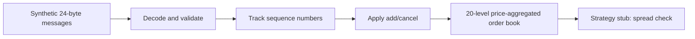
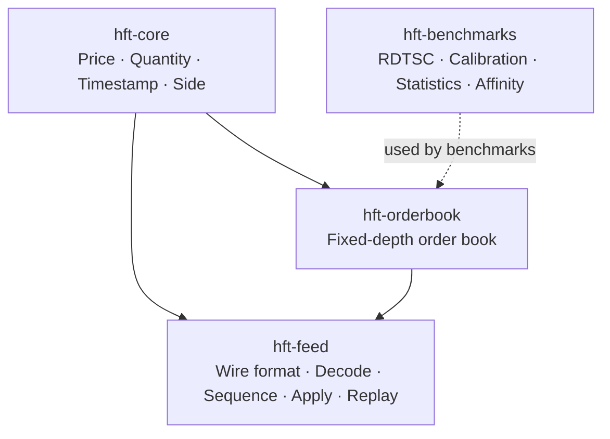

[](https://github.com/Ghaith8Bit/simple-hft-engine/actions/workflows/ci.yml)

# simple-hft-engine

A small Rust project that decodes a synthetic market-data format, tracks message sequence numbers, updates a fixed-depth limit order book, and measures selected operations.

**Start with the pictures:** [Visual guide](docs/visual-guide.md)

## The idea in one picture



The pipeline shown above is the local synthetic pipeline in `crates/hft-feed/src/bin/pipeline.rs`. It is not a live exchange connection. The separate `udp_demo` binary receives UDP messages.

## What is inside?



| Crate | Responsibility |
|---|---|
| `hft-core` | Core value types; `no_std` outside tests |
| `hft-orderbook` | Fixed-depth order book with price-aggregated levels |
| `hft-feed` | Synthetic wire format, decoder, sequence tracking, application, replay, pipeline and UDP demo |
| `hft-benchmarks` | TSC timing, calibration, statistics and CPU-affinity helpers |

## What the measurements say

These are the figures documented in [`BENCHMARKS.md`](BENCHMARKS.md), along with their measurement methods and limitations.

| Measurement | Reported result | Important qualification |
|---|---:|---|
| `best_bid` / `best_ask` reads | 1–3 ns p50; 5–8 ns p99.9 across runs | RDTSC, baseline-subtracted; results are sensitive to measurement effects |
| `timestamp_now()` | 28 ns | RDTSC, baseline-subtracted |
| `decode_add` | 3.17 ns | Criterion `iter()` |
| Order-book mutations | 61.1–72.9 ns | Criterion `iter_batched` upper bounds; harness overhead dominates |
| Synthetic in-memory pipeline | 68.1M messages/sec median | 100,000-message cache-warm stream; not network throughput |
| Decoder fuzz run | 18.5M inputs in 61 seconds, no crashes or panics | Recorded fuzz run; CI only builds the fuzz target |

Do not compare these figures without reading the method and caveats. The benchmark suite intentionally labels upper bounds as upper bounds.

## Run it

```bash
cargo test --workspace --release
cargo run -p hft-feed --release --bin pipeline
cargo run -p hft-feed --release --bin pipeline -- --runs 5 --quiet
cargo bench -p hft-orderbook --bench book_rdtsc
cargo bench -p hft-feed --bench decode
```

The pipeline generates 100,000 synthetic messages by default. `--runs 5 --quiet` runs five timed passes after the warmup and reports the median and range. The code rejects `--runs 0`.

## Read in this order

1. [Visual guide](docs/visual-guide.md) — the whole project, one diagram at a time.
2. [Glossary](docs/glossary.md) — short definitions of the terms used.
3. [Benchmarks](BENCHMARKS.md) — results, methodology, and limitations.
4. [Portfolio engineering notes](PORTFOLIO.md) — design problems and trade-offs.

## Scope and limitations

This repository is a systems-learning and portfolio project, not a production exchange gateway. The synthetic pipeline is in-memory; `udp_demo` is a separate demo and its network latency is not benchmarked. The strategy is a spread-threshold stub. The book stores aggregated quantity per price, has a fixed depth of 20 levels per side, and does not track individual order identity or perform matching.

## License

MIT — see [`LICENSE`](LICENSE).
