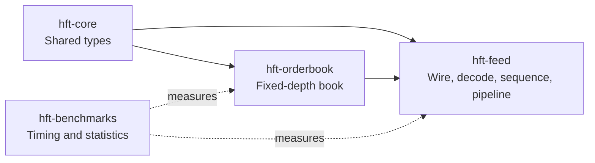
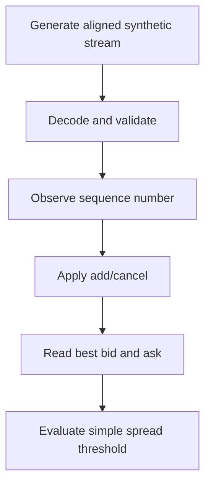

# Architecture

## Workspace boundaries

- `hft-core`: shared types such as `Price`, `Quantity`, `Timestamp`, and `Side`.
- `hft-orderbook`: fixed-depth, price-aggregated order book.
- `hft-feed`: synthetic wire representation, decoding, sequence tracking, replay helpers, and demo binaries.
- `hft-benchmarks`: timing, statistics, and CPU-affinity utilities.

`hft-core` and `hft-orderbook` support `no_std` outside test configurations. Feed and benchmark tools use standard-library facilities.

## In-memory processing path

The default pipeline workload contains 100,000 generated messages. The stream is generated before the timed loop. Unless `--no-warmup` is supplied, a warm-up pass is performed.

The sequence tracker reports anomalies but does not reorder or recover messages. The current pipeline still applies successfully decoded messages after duplicate or out-of-order observations. This is demonstration behavior, not a production feed policy.

## UDP path

The UDP demo is a separate executable path, not the transport used by the in-memory benchmark. UDP itself does not guarantee delivery, ordering, or retransmission.

## Non-goals

The repository does not implement a live exchange connection, production recovery, individual order identity, time-priority matching, durable market-data storage, or a complete execution stack.
