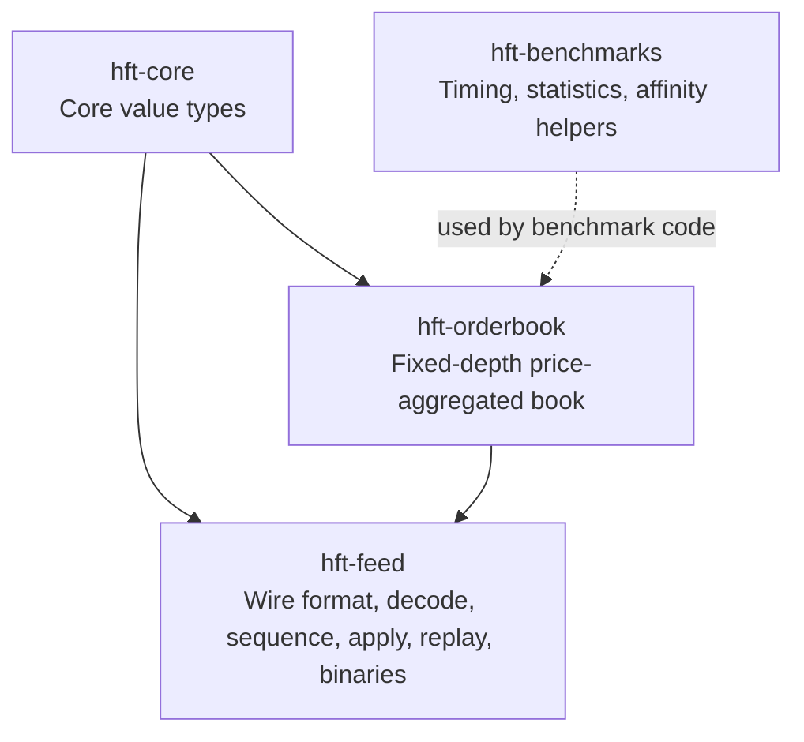
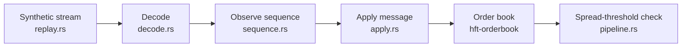
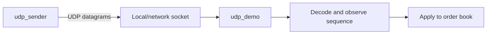

# Architecture

The repository is a learning prototype with two distinct ways to feed messages into processing: the synthetic in-memory pipeline and a separate UDP demo. Do not read the UDP demo as a stage inside the pipeline.

## Workspace

The crate names and responsibilities above come from the workspace manifests and source modules.

## In-memory pipeline

The current pipeline observes sequence events but does not stop application when an event is a gap, duplicate, or out-of-order message. See [Pipeline and sequence handling](pipeline-and-sequence.md).

## Separate UDP demo

The UDP demo has its own receive loop. The in-memory pipeline benchmark does not measure the UDP socket path.

## Where to look

| Concern | Source |
|---|---|
| Core value types | `crates/hft-core/src/lib.rs` |
| Wire structs and aligned buffer | `crates/hft-feed/src/wire.rs` |
| Encode helpers and synthetic stream | `crates/hft-feed/src/replay.rs` |
| Decoder | `crates/hft-feed/src/decode.rs` |
| Sequence tracker | `crates/hft-feed/src/sequence.rs` |
| Message application | `crates/hft-feed/src/apply.rs` |
| Order book | `crates/hft-orderbook/src/lib.rs` |
| In-memory pipeline | `crates/hft-feed/src/bin/pipeline.rs` |
| UDP sender and receiver | `crates/hft-feed/src/bin/udp_sender.rs`, `udp_demo.rs` |
