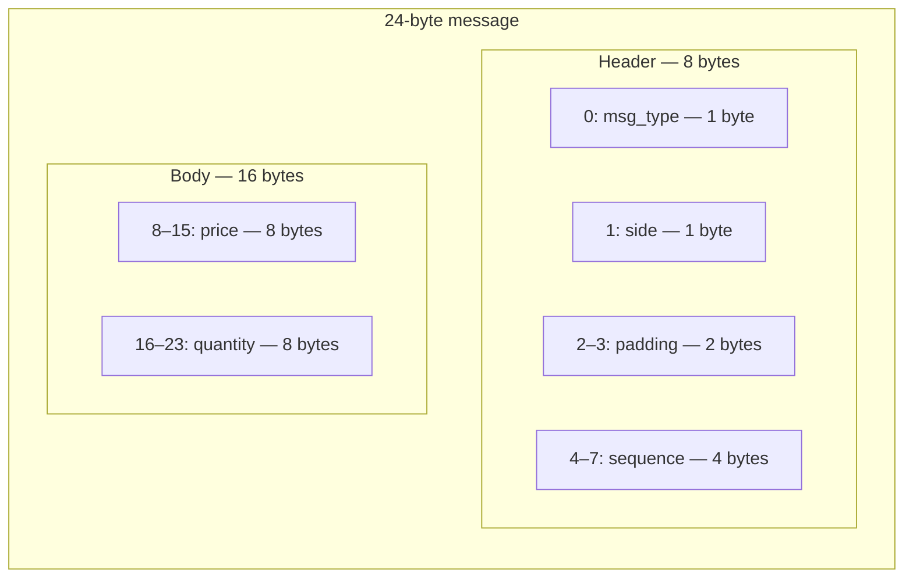

# Message format and zero-copy decoding

This guide follows the implementation in `crates/hft-feed/src/wire.rs`, `decode.rs`, and `replay.rs`.

## The 24-byte layout

The current synthetic format defines two message types: add (`A`) and cancel (`X`). Both use the same overall field layout.

The offsets and field widths above follow the source layout. The wire module documents this format as little-endian and x86_64-native; do not assume it is a portable network encoding on every architecture.

## What each field means

| Field | Meaning in this project |
|---|---|
| `msg_type` | `A` for add or `X` for cancel |
| `side` | `0` for bid, `1` for ask |
| `seq` | Sequence number used by the tracker |
| `price` | Signed 64-bit integer used as the price value |
| `qty` | Unsigned 64-bit quantity |
| padding | Two bytes included in the header layout |

The core `Price` type documents fixed-point scaling by 10^8, but the synthetic feed examples use small integer values for readability. Keep that distinction in mind when interpreting examples.

## Why alignment exists

A type containing 64-bit fields has alignment requirements. The decoder uses `zerocopy` to interpret bytes as a typed message reference, so the input address must meet the type's alignment requirement.

`AlignedMsg` wraps a 24-byte array with `#[repr(C, align(8))]`. That makes the buffer type require 8-byte alignment. The decoder reports `DecodeError::Unaligned` if the typed reference cannot be formed.

## What zero-copy means here

The decoder returns `Message::Add(&AddOrderMsg)` or `Message::Cancel(&CancelMsg)`. The returned reference points into the original input bytes; it is not a newly allocated decoded copy. The test `decode_borrows_from_input` checks that the decoded reference and input buffer start at the same address.

This does **not** mean that the whole application performs no work or that all operations are allocation-free. It describes the decoder's representation of a message.

## Validation performed by decode

The current decoder checks:
- empty input;
- input shorter than the 24-byte message size;
- message type;
- alignment required for the typed reference;
- side values greater than 1.

It does not currently validate all possible business rules, such as price ranges or whether quantity is meaningful for a given operation.

## Source tour

1. Read the `Header`, `AddOrderMsg`, and `CancelMsg` structs in `wire.rs`.
2. Find the compile-time size and alignment assertions.
3. Read `AlignedMsg` and its slice methods.
4. Follow the branches in `decode()`.
5. Read `decode_borrows_from_input` and `decode_unaligned_returns_error` in the decoder tests.
