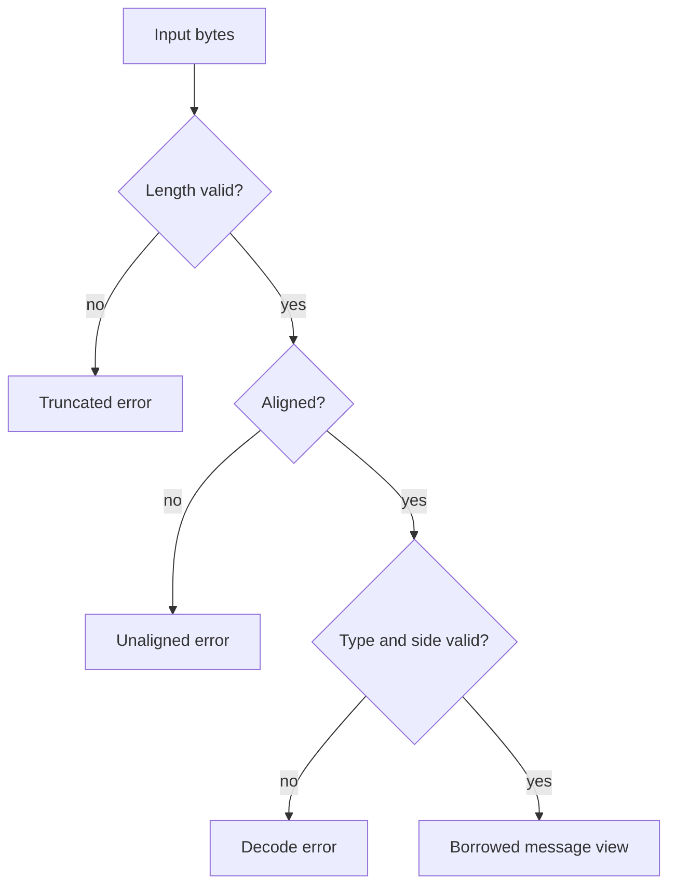

# Message format and decoding

## Layout

The synthetic message is 24 bytes: an 8-byte header and a 16-byte body. Integer fields are little-endian; the implementation documents an x86_64-oriented layout assumption.

| Offset | Size | Field | Meaning |
|---:|---:|---|---|
| 0 | 1 | `msg_type` | `b'A'` add, `b'X'` cancel |
| 1 | 1 | `side` | `0` bid, `1` ask |
| 2–3 | 2 | padding | Reserved |
| 4–7 | 4 | `seq` | Sequence number (`u32`) |
| 8–15 | 8 | `price` | Signed price (`i64`) |
| 16–23 | 8 | `qty` | Quantity (`u64`) |

The message structs use `#[repr(C)]` and `zerocopy` derives. Compile-time assertions check relevant sizes; the add-message alignment is asserted to be 8 bytes.

## Alignment and zero-copy

The decoder borrows a typed view from the input bytes rather than copying fields into a new owned structure. This still requires validation. An ordinary `Vec<u8>` does not promise the typed alignment required by this decoder.

`AlignedMsg` wraps `[u8; 24]` with `#[repr(C, align(8))]`; a `Vec<AlignedMsg>` provides aligned elements. Unaligned input is rejected.

## Decode errors

- `Empty`: no bytes supplied.
- `Truncated`: fewer bytes than expected.
- `Unaligned`: required alignment is not met.
- `UnknownType(u8)`: unsupported message type.
- `BadSide(u8)`: invalid side value.

Tests cover round-tripping, malformed input, alignment rejection, and borrowed-view pointer identity.

This is a synthetic format, not an exchange protocol. It has no version negotiation, checksum, authentication, or general cross-architecture portability guarantee.
