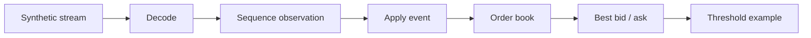

# Pipeline and sequence tracking

## Pipeline

The pipeline generates an aligned synthetic stream, then processes each message by decoding it, observing its sequence number, applying the add/cancel event, and reading the best bid and ask. It then evaluates a simple spread-threshold condition.



The stream is generated before the timed loop. The default workload is 100,000 messages. `--runs` controls run count and must be greater than zero; `--quiet` reduces output; `--no-warmup` disables the warm-up pass.

## Sequence classifications

| Result | Meaning |
|---|---|
| `First` | First sequence number observed |
| `Normal` | Expected next number |
| `Gap` | Forward jump suggests missing values |
| `Duplicate` | Sequence repeated |
| `OutOfOrder` | Number arrived behind expected position |

The tracker counts gaps, estimated lost messages, duplicates, and out-of-order observations. Its wrapping comparison is a heuristic for a mostly ordered stream with occasional anomalies.

## Detection is not recovery

The tracker does not reorder messages, request retransmission, recover missing ranges, reconcile snapshots, or handle multiple sequence epochs. The current pipeline still applies successfully decoded messages even after duplicate/out-of-order observations. This behavior demonstrates component separation, not a recommended production policy.

```bash
cargo run -p hft-feed --release --bin pipeline
cargo run -p hft-feed --release --bin pipeline -- --runs 5 --quiet
```

The pipeline is in-memory. The UDP demonstration is separate.
