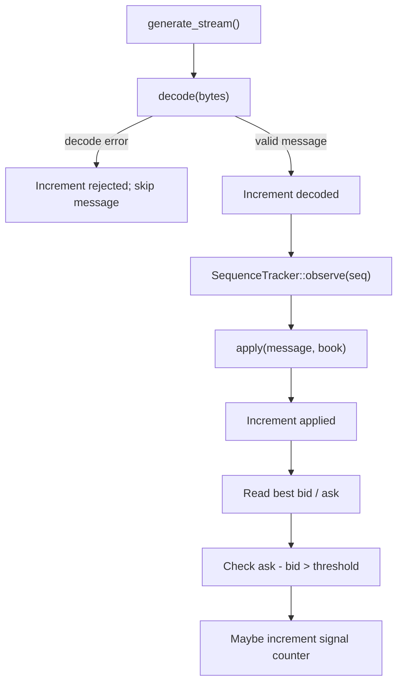

# Pipeline and sequence handling

This guide describes what the current code does, including a known correctness limitation.

## The in-memory path

This order follows `crates/hft-feed/src/bin/pipeline.rs`. Stream generation occurs before the timed loop. The pipeline counts a message as decoded after decoding succeeds and increments the applied count after calling `apply`.

## Sequence events

The tracker classifies:
- `First`: no previous sequence number was recorded;
- `Normal`: the next expected sequence arrives;
- `Gap`: a forward jump suggests one or more missing sequence numbers;
- `Duplicate`: the sequence number equals the last tracked sequence;
- `OutOfOrder`: a sequence number is older than the tracked sequence under the tracker’s comparison logic.

The tracker records statistics. It does not fetch missing messages, request a snapshot, or reconstruct the order book.

## Known correctness limitation

**The current pipeline observes the sequence event and then applies the decoded message regardless of whether the event is a gap, duplicate, or out-of-order arrival.**

That means the tracker reports anomalies but does not by itself protect the book from being updated with a duplicate or out-of-order message. The correct policy is a design decision that needs explicit implementation and tests; this documentation does not claim that policy is already implemented.

## What the signal counter means

The pipeline checks whether both best bid and best ask exist, then increments `signals` when `ask.price - bid.price > SPREAD_THRESHOLD`. It performs this check as messages are processed.

The counter is not a count of executed trades, profitable opportunities, or validated strategy outcomes. It is a simple demonstration signal.

## In-memory pipeline versus UDP

The `pipeline` binary processes a generated stream in memory. The `udp_demo` binary receives datagrams in a separate loop and uses its own sequence tracker and order book. A successful local UDP run does not establish that UDP guarantees delivery or ordering.

## Questions to investigate

- Should duplicate messages be skipped before applying them?
- What should the consumer do after a sequence gap?
- Should out-of-order messages be buffered, rejected, or trigger resynchronization?
- How should sequence-number wraparound be handled by the tracker?
- What tests demonstrate that the chosen policy keeps the book consistent?
