# Visual guide: simple-hft-engine

Read top to bottom. The diagrams carry the explanation; each caption adds only the context needed to avoid misleading conclusions.

## 01. What is a market-data engine?

A message is a small record of an update. This project practices reading those records and maintaining a compact view of prices.

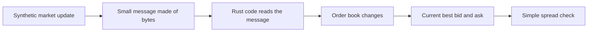

## 02. What does this project do?

The main local pipeline uses generated messages. It decodes them, observes sequence numbers, applies updates, then checks the spread.

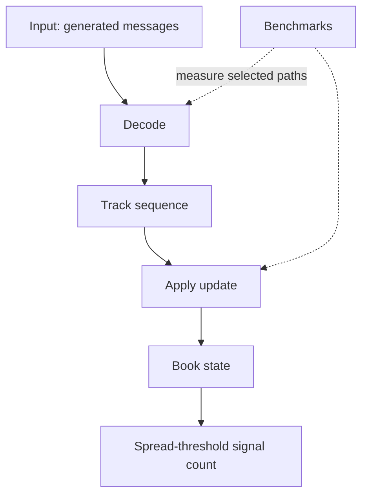

## 03. What are we balancing?

The code and benchmarks cover correctness checks, performance measurements, and visibility into sequence anomalies. The diagram is a framing aid, not a claim of production completeness.

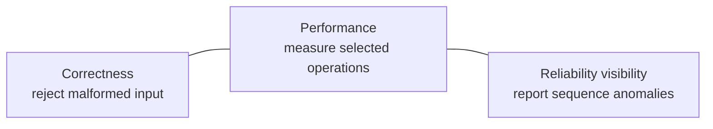

## 04. The system at a glance

The four crates and their relationships are taken from the workspace manifests and source modules.

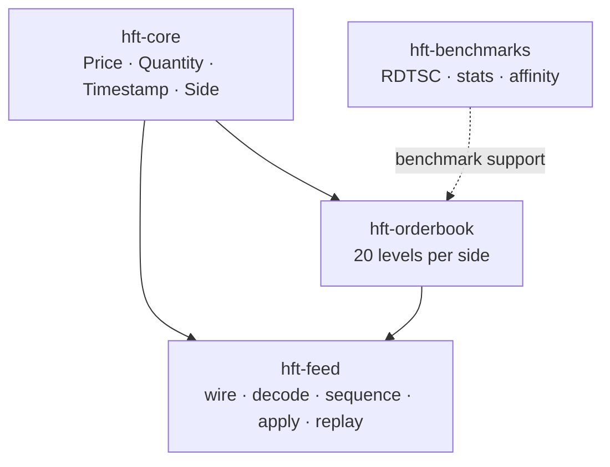

## 05. Follow one message

The sequence follows the pipeline code: decode first; observe sequence; apply; inspect the book; perform the spread-threshold check. Invalid decode input exits the loop iteration.

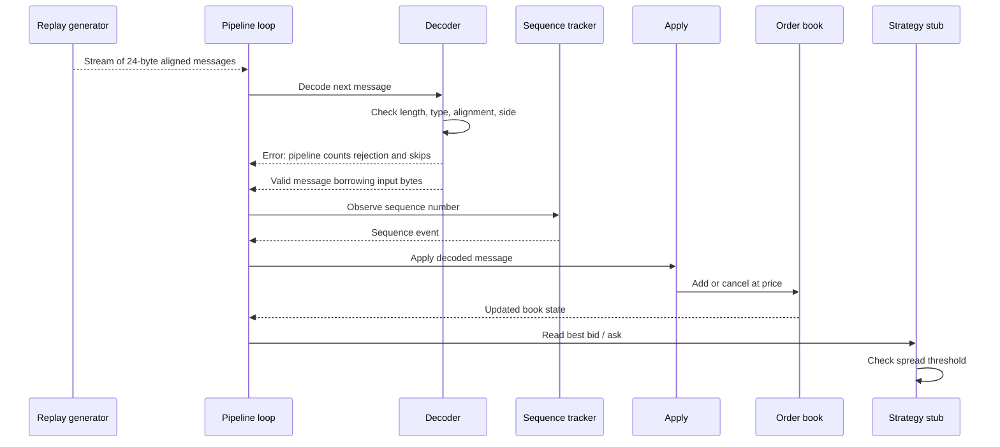

## 06. What happens to invalid bytes?

The decoder returns explicit errors for empty, truncated, unaligned, unknown-type, and invalid-side input. In the pipeline, decode errors are counted as rejected and skipped.

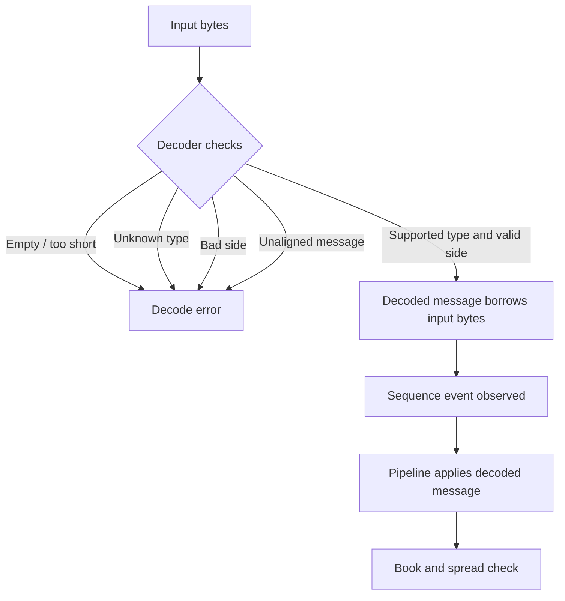

## 07. Read the order book

The illustration uses the benchmark's example setup: bids at 100, 98, 96 and asks at 102, 104, 106, with quantity 10 at each shown level. These are example internal values, not quoted real-world prices.

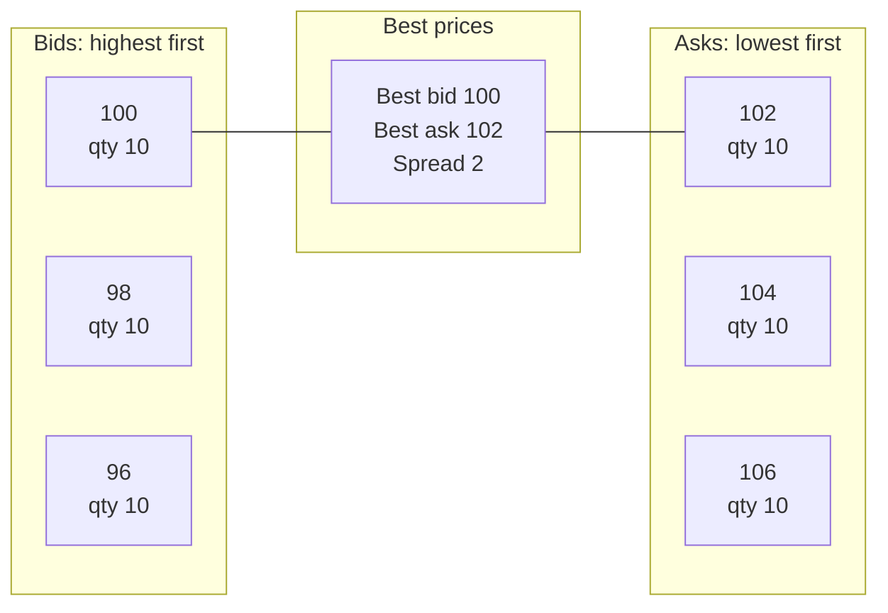

## 08. Understand sequence tracking

The tracker distinguishes first, normal, gap, duplicate, and out-of-order events. It detects anomalies but does not implement feed recovery. The pipeline still applies successfully decoded messages after observing the event.

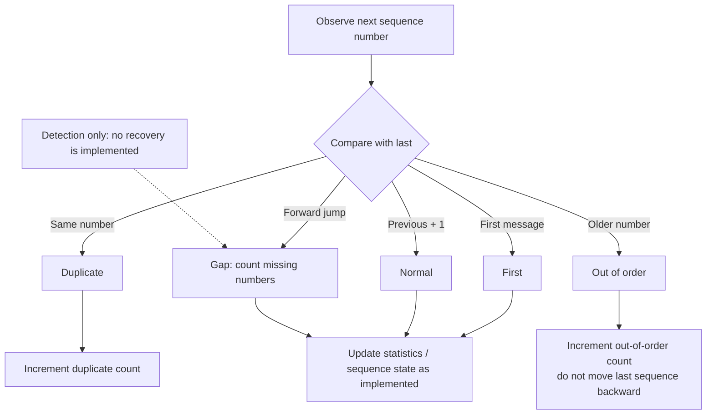

## 09. Why memory alignment matters

The synthetic message is 24 bytes and the typed message needs 8-byte alignment. `AlignedMsg` provides an 8-byte-aligned buffer; unaligned input returns an error.

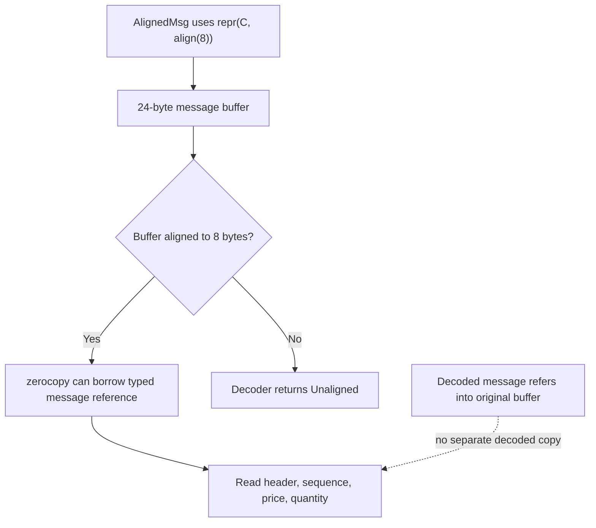

## 10. What happens inside processing?

The decoder returns `Message::Add` or `Message::Cancel`; `apply` maps it to an order-book add or cancel operation. The pipeline then reads best bid/ask for its spread check.

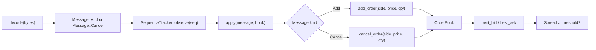

## 11. How are results measured?

Different workloads use different tools. Mutation measurements are explicitly upper bounds because Criterion's batch overhead dominates the operation.

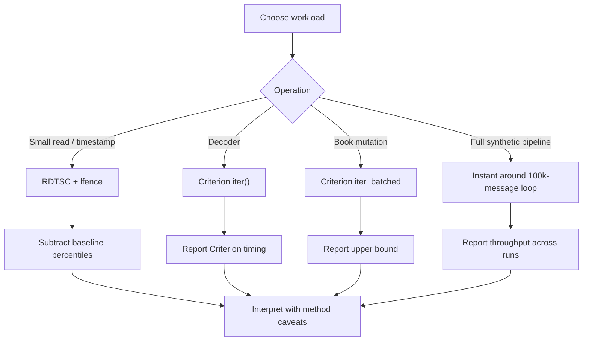

## 12. How is it checked?

CI runs formatting, Clippy, tests, benchmark compilation, an informational RDTSC benchmark, an audit, and an informational fuzz-target build. A separate fuzz run is recorded in the existing benchmark notes.

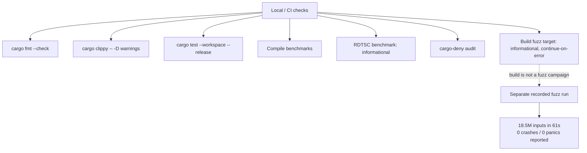

## 13. How do I run it?

Use the commands below to run tests, the synthetic pipeline, and individual benchmarks. See `BENCHMARKS.md` before interpreting the output.

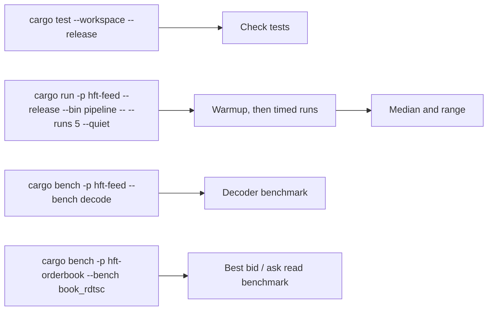

## 14. What does it not prove?

The scope boundaries are explicit in the code and benchmark notes. In particular, the strategy is a stub and the in-memory benchmark is not network throughput.

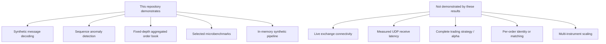

## Useful commands

```bash
cargo test --workspace --release
cargo run -p hft-feed --release --bin pipeline -- --runs 5 --quiet
cargo bench -p hft-feed --bench decode
cargo bench -p hft-orderbook --bench book_rdtsc
```

For exact reported results, environment, methodology, and limitations, see [`../BENCHMARKS.md`](../BENCHMARKS.md). For definitions, see [`glossary.md`](glossary.md).
