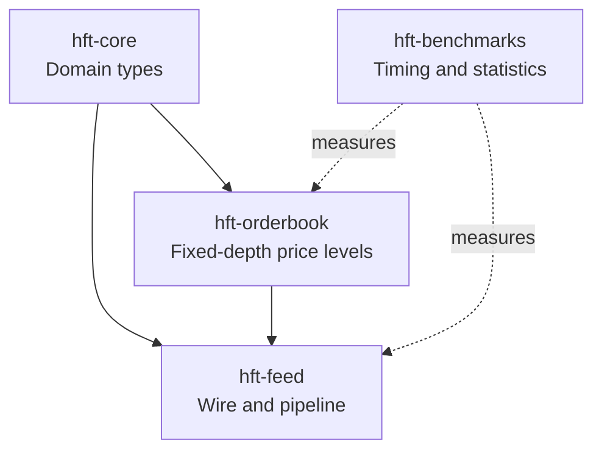
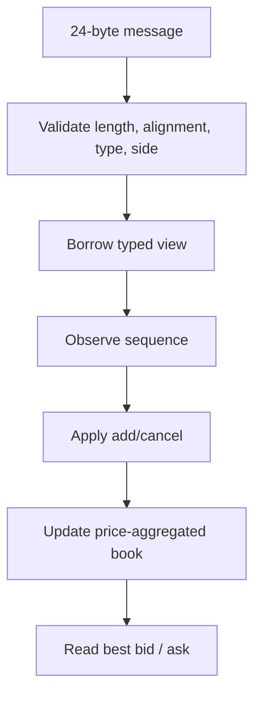
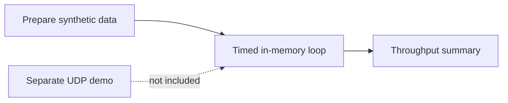

# Visual guide

These diagrams describe the current prototype, not a production exchange architecture.

## Workspace



## Message processing



Invalid input fails decoding. Sequence tracking detects anomalies but does not recover them; the current pipeline still applies successfully decoded messages after sequence observation.

## Message layout

```text
0       1       2       4                       8
| type  | side  | padding | sequence number     |
| price (8 bytes)                         |
| quantity (8 bytes)                      |
Total: 24 bytes
```

See [message-format.md](message-format.md) for the field table.

## Order-book levels

```text
Bids: highest price -> lowest price
Asks: lowest price  -> highest price
Index 0 is best on each side.
Each side retains at most 20 price levels.
```

## Benchmark boundary


